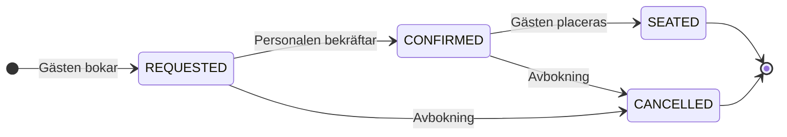

<div align="center">

# 🍽️ Restaurant API

### Bordsbokning – från reservation till dukat bord

*REST-API för restauranger och bordsbokningar.*


[Á la carte](#-à-la-carte--implementerade-funktioner) ·
[Dukning](#-dukning--kom-igång-lokalt) ·
[Servering](#-servering--använd-apit) ·
[Köket](#-köket--projektstruktur) ·
[Smakprov](#-smakprov--tester-och-ci) ·
[Ej på menyn](#-ej-på-menyn--nuvarande-begränsningar)

</div>

---

> **Välkommen till bords.** Gäster kan skapa och läsa sina egna bokningar. Personalen bekräftar bokningar, placerar gäster och avbokar. Administratörer hanterar restauranger.

Projektet började som en inlämningsuppgift i Java Web Services. API:t använder Java 25, Spring Boot 4.1.0, Spring Data JPA och Spring Security med Auth0. H2 används lokalt och PostgreSQL i produktionsprofilen.

## 📜 À la carte – implementerade funktioner

| | Rätt | Beskrivning |
|---|---|---|
| 🏠 | **Restauranger** | Lista restauranger med paginering, hämta en restaurang samt skapa och uppdatera restauranger som administratör. |
| 📅 | **Bokningar** | Skapa bokningar och hantera statusarna `REQUESTED`, `CONFIRMED`, `SEATED` och `CANCELLED`. |
| 🔒 | **Egna bokningar** | Gäster ser bara sina egna bokningar. Personal kan läsa alla bokningar. |
| 🪑 | **Kapacitet** | Kapacitetskontroll vid bokning, även vid samtidiga anrop. En bokning upptar platser i 120 minuter. Högst 8 gäster per bokning tillåts som standard; gränsen är konfigurerbar. |
| ✅ | **Validering** | Validering av bokningstid och sällskapets storlek samt enhetliga felsvar med `ProblemDetail`. |
| 🔗 | **HATEOAS** | HATEOAS-länkar för bokningsåtgärder och ETag vid hämtning av en bokning. |

### En bokning från dörr till bord



`SEATED` och `CANCELLED` är slutstatusar. Placerade gäster upptar fortfarande platser tills bokningens tid är slut.

## 🕯️ Dukning – kom igång lokalt

Installera JDK 25 och se till att `JAVA_HOME` pekar på installationen. Maven Wrapper i repot använder Maven 3.9.11 och hämtar Maven och beroenden vid behov.

Kör från repots rot i PowerShell:

```powershell
.\mvnw.cmd -pl backend spring-boot:run
```

På Linux eller macOS:

```bash
./mvnw -pl backend spring-boot:run
```

API:t startar på port 8080. Den lokala H2-databasen fylls med exempeldata från `backend/src/main/resources/data.sql`. Data återställs vid omstart.

Kontrollera tjänsten i ett annat terminalfönster. I PowerShell:

```powershell
curl.exe http://localhost:8080/health
```

På Linux eller macOS används `curl` i stället för `curl.exe`. Förväntat svar:

```json
{"status":"UP","service":"restaurant-api"}
```

### Lokal konfiguration

Standardvärdena finns i [application.yaml](backend/src/main/resources/application.yaml). Auth0 används även vid lokal körning. För att använda en egen Auth0-tenant behöver API, klient och roller sättas upp enligt [Auth0-guiden](auth0/README.md).

| Miljövariabel | Användning |
|---|---|
| `PORT` | API:ts port, standardvärde `8080`. |
| `JWT_ISSUER_URI` | Auth0-issuer. Har ett standardvärde för projektets tenant. |
| `JWT_AUDIENCE` | API:ts audience, standardvärde `https://restaurant-api`. |
| `SWAGGER_CLIENT_ID` | Den publika Auth0-klienten för Swagger UI. Har ett standardvärde för projektets klient. |
| `CORS_ALLOWED_ORIGINS` | Tillåtna klientadresser, standardvärde `http://localhost:5173`. |

Profilen `prod` använder PostgreSQL och miljövariablerna `DB_HOST`, `DB_PORT`, `DB_NAME`, `DB_USER` och `DB_PASSWORD`. Se [driftguiden](deploy/README.md) för uppsättning och deploy.

## 🛎️ Servering – använd API:t

När tjänsten körs lokalt finns:

- 📖 [Swagger UI](http://localhost:8080/swagger-ui.html) för att läsa dokumentationen och prova anrop.
- 📋 [OpenAPI](http://localhost:8080/v3/api-docs) med API:ts specifikation.
- 💚 [Hälsokontroll](http://localhost:8080/health).

`GET /health`, läsning av restauranger och API-dokumentationen är publika. Skyddade anrop använder en access token från Auth0 i `Authorization: Bearer <access-token>`. Logga in via **Authorize** i Swagger UI. Använd en access token, inte en ID-token.

### Vem gör vad i restaurangen

| Roll | | Åtkomst |
|---|---|---|
| `GUEST` | 🧑 Gästen | Läser egna bokningar. Skapar bokningar med scopet `bookings:write`. |
| `STAFF` | 🤵 Personalen | Läser alla bokningar. Bekräftar, placerar och avbokar med scopet `bookings:manage`. |
| `ADMIN` | 👨‍🍳 Krögaren | Skapar och uppdaterar restauranger med scopet `restaurants:write`. |

> [!IMPORTANT]
> Roll och scope måste matcha för skrivande anrop. Rollerna ger inte automatiskt varandras rättigheter. Detaljer om roller, klienter och token finns i [Auth0-guiden](auth0/README.md).

### Exempelanrop

[request.http/requests.http](request.http/requests.http) innehåller API-anrop och [request.http/kapacitetskontroll.http](request.http/kapacitetskontroll.http) innehåller scenarier för kapacitetskontrollen.

Öppna filerna i IntelliJ HTTP Client. Välj miljön `local` och kontrollera att värden är `http://localhost:8080` innan du kör lokala anrop. `requests.http` har också en egen `@host`-rad som behöver ändras för lokal körning. Lägg access tokens i den ignorerade filen `http-client.private.env.json`, enligt instruktionerna i anropsfilen.

## 🧑‍🍳 Köket – projektstruktur

```text
backend/
    pom.xml                     Applikationens beroenden och bygginställningar
    src/main/java/              Restauranger, bokningar, säkerhet och felhantering
    src/main/resources/         Konfiguration och lokala exempeldata
    src/test/java/              Automatiserade tester
    Dockerfile                  Container för API:t
auth0/                          Auth0-uppsättning och rolltilldelning
deploy/                         Docker Compose, Caddy och driftskript
request.http/                   Manuella API-anrop
docs/architecture.md            Arkitekturöversikt
docs/decisions/                 Dokumenterade beslut för genomförda ändringar
pom.xml                         Maven-aggregator för backend
mvnw, mvnw.cmd                  Maven Wrapper
CHANGELOG.md                    Ändringslogg
AGENTS.md                       Arbetsregler för AI-agenter
```

Frontend och bild-API ligger i separata repon. Driftfilerna i `deploy/` beskriver hur tjänsterna körs tillsammans.

## 🥄 Smakprov – tester och CI

Kör testerna från repots rot i PowerShell:

```powershell
.\mvnw.cmd test
```

På Linux eller macOS:

```bash
./mvnw test
```

Testerna täcker bland annat bokningsflödet, behörigheter, ägarkontroll, kapacitet, samtidiga bokningar och ändring av restaurangens platsantal. Testerna använder lokal testkonfiguration och kräver inga riktiga Auth0-tokens.

[GitHub Actions](.github/workflows/ci.yml) kör `./mvnw -B -ntp clean test` med Java 25 vid push och pull requests. Den aktuella workflow-filen bygger och testar projektet. Publicering och deploy ingår inte i den.

## 📚 Receptsamlingen – vidare dokumentation

- [Arkitektur](docs/architecture.md): komponenter, ansvar och tekniska vägval.
- [Beslut](docs/decisions/): vad som har byggts och varför.
- [Ändringslogg](CHANGELOG.md): genomförda ändringar.
- [Auth0](auth0/README.md): autentisering, roller och klientinställningar.
- [Drift](deploy/README.md): Docker Compose, VPS, deploy och rollback. Avsnittet om automatisk deploy behöver stämmas av mot den aktuella CI-konfigurationen.

### Utvecklingsrutiner

[AGENTS.md](AGENTS.md) beskriver arbetsregler och rutinen för nya funktioner. Publika beslut finns i `docs/decisions/`; privat planering ingår inte i repot.

## 🚫 Ej på menyn – nuvarande begränsningar

- Gäster kan inte avboka eller ändra sina bokningar själva. Avbokning hanteras av personalen.
- Bokningsbekräftelser simuleras genom loggning. Ingen faktisk e-post eller påminnelse skickas.
- Kapacitet räknas som en gemensam pool av platser. Enskilda bord, öppettider och faktisk besökslängd hanteras inte.
- Reservationsbelopp, deposition och betalningshantering ingår inte.

---

<div align="center">

*Smaklig måltid – och lycka till med bokningen.* 🥂

</div>
