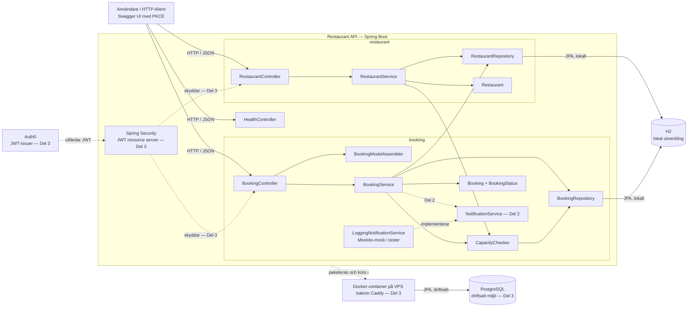

# Arkitekturöversikt

## Syfte

Det här dokumentet beskriver projektets målarkitektur genom uppgiftens fyra delar. Målet är G (beslut 2026-10-13). `docs/backlog/` bestämmer funktionell omfattning. Detaljerad implementationsordning hör hemma i respektive planfil, exempelvis `done/plan-del1.md`.

Projektet byggs som en Spring Boot-monolit organiserad med **package-by-feature** och en lätt lagerindelning inom varje feature. Strukturen ska vara enkel att navigera, testa och förklara vid redovisningen utan att införa fler abstraktioner än kraven behöver.

## Arkitekturstil

Följande beslut gäller:

- En enda Spring Boot-applikation i `backend/`.
- Den frivilliga frontenden ligger i `frontend/` (React, Vite och TypeScript). Den är en statisk sida som anropar API:t med en Auth0-token och innehåller ingen affärslogik.
- Paket organiseras efter funktion: restauranger och bokningar.
- Controller, representation assembler, service, repository, entitet och DTO ligger nära sin feature.
- Features är organisatoriska paket, inte strikt isolerade moduler.
- Serviceklasser är konkreta; de får inte interface utan ett verkligt behov.
- `NotificationService` blir ett interface i Del 2 eftersom kravet uttryckligen behöver en mockningsbar seam.
- Cross-cutting Spring-konfiguration hålls i `config`.
- Ingen Clean Architecture, hexagonal arkitektur eller full modulär monolit införs.

## Övergripande systembild



Heldragna relationer beskriver Del 1:s centrala flöde. Streckade relationer är planerade komponenter för senare delar och är inte implementerade ännu.

## Paketstruktur

```text
se.edugrade.java25.restaurant
├── RestaurantApiApplication
├── health
│   └── HealthController
├── restaurant
│   ├── Restaurant
│   ├── RestaurantRepository
│   ├── RestaurantService
│   ├── RestaurantController
│   ├── RestaurantCreateRequest
│   ├── RestaurantResponse
│   └── RestaurantNotFoundException
├── booking
│   ├── Booking
│   ├── BookingStatus
│   ├── BookingRepository
│   ├── BookingService
│   ├── CapacityChecker
│   ├── BookingController
│   ├── BookingModelAssembler
│   ├── BookingCreateRequest
│   ├── BookingResponse
│   ├── BookingNotFoundException
│   ├── InvalidBookingStateException
│   ├── InvalidBookingRequestException
│   ├── InsufficientCapacityException
│   ├── NotificationService       # införs i Del 2
│   └── LoggingNotificationService # simulerad avisering i Del 2
├── exception
│   └── ApiExceptionHandler
└── config
    ├── ClockConfig
    ├── SecurityConfig            # införs i Del 3
    ├── RestaurantAuthoritiesConverter # införs i Del 3
    └── CorsConfig                # införs i Del 3
```

Paket hålls platta så länge de är lätta att navigera. Underpaket som `dto`, `persistence` eller `web` skapas först om en feature faktiskt blir så stor att en platt struktur blir otydlig.

Tester speglar produktionskodens featurestruktur:

```text
src/test/java/se/edugrade/java25/restaurant
├── RestaurantApiApplicationTests
├── restaurant
├── booking
└── security
```

## Ansvar och beroenderiktning

```text
HTTP → Controller → Service → Repository → Database
                         ↓
                       Entity
```

### Controller

Controllern äger HTTP-gränsen:

- request- och response-DTO:er,
- validering av inkommande request,
- lyckade HTTP-svar, statuskoder och `Location`,
- ETag och `If-None-Match`,
- användning av `BookingModelAssembler` för HATEOAS-representationer,
- delegering till servicelagret.

Controllern returnerar aldrig en JPA-entitet.

### Representation assembler

`BookingModelAssembler` är en Spring-komponent som implementerar `RepresentationModelAssembler<BookingResponse, EntityModel<BookingResponse>>`. Den omvandlar bokningens response-DTO till en HATEOAS-representation och bygger endast länkar för de övergångar som `BookingStatus.canTransitionTo(...)` tillåter.

Assemblaren tillhör HTTP-gränsen och injiceras i `BookingController`. Den hämtar inte data, ändrar inte bokningens tillstånd och innehåller ingen affärsregel utöver att återanvända domänens övergångstabell. `BookingResponse.from(...)` ansvarar fortsatt för entitet-till-DTO-mappningen, medan assemblaren ansvarar för DTO-till-HATEOAS-mappningen.

### Service

Servicen äger användningsfallet:

- uppslagning och skapande av resurser,
- transaktionsgränser,
- orkestrering mellan repositories och domänobjekt,
- signalering av saknade resurser och otillåtna övergångar.

Services är oberoende av HTTP och signalerar saknade resurser och otillåtna tillståndsövergångar med egna exceptions i respektive feature. `RestaurantNotFoundException` ligger i `restaurant`; `BookingNotFoundException`, `InvalidBookingStateException`, `InvalidBookingRequestException` och `InsufficientCapacityException` ligger i `booking`.

`exception.ApiExceptionHandler` är projektets enda `@RestControllerAdvice`. Den översätter feature-exceptions, valideringsfel och oväntade fel till konsekventa `ProblemDetail`-svar med rätt HTTP-status. `InvalidBookingRequestException` ger 400, `InsufficientCapacityException` ger 409 och ett misslyckat databaslås ger 503. Därmed ligger affärsregeln nära sin feature medan HTTP-översättningen är samlad på ett ställe.

`RestaurantService` och `BookingService` är konkreta klasser. Interface skulle vara en ytlig seam eftersom det bara finns en implementation och inget krav på utbytbarhet.

### Entity och domänregel

Entiteterna innehåller persistent tillstånd. `BookingStatus` och `Booking.transitionTo(...)` är den gemensamma sanningskällan för bokningens övergångar:

```text
REQUESTED → CONFIRMED → SEATED
     │            │
     └────────────┴──→ CANCELLED
```

HATEOAS-länkar och statusändringar använder samma övergångsregel så att API:t aldrig visar en handling som domänen nekar.

### Repository

Repositories är Spring Data JPA-interface och ansvarar endast för persistens. Egna repository-interface ovanpå Spring Data, custom queries och persistence adapters skapas inte utan ett konkret krav.

### DTO

Request- och response-DTO:er definierar det publika HTTP-kontraktet. De ligger i samma feature som använder dem och hindrar JPA-detaljer, relationer och intern implementation från att exponeras till klienten. Response-DTO:erna äger den manuella entitet-till-DTO-mappningen i en statisk `from(...)`-metod; den skapar API-kontraktet men exponerar aldrig entiteten för klienten.

### Relation mellan features

`BookingService` får använda `RestaurantRepository` för att kontrollera och koppla den restaurang som en bokning tillhör. `RestaurantService` använder `booking.CapacityChecker` vid sänkt `seatCount`; beroendet från `restaurant` till `booking` accepteras eftersom paketgränserna organiserar en enda applikation.

## Kapacitetskontroll

`BookingService.create` och `RestaurantService.update` låser samma restaurangrad med `PESSIMISTIC_WRITE` före kapacitetskontrollen. `CapacityChecker` räknar högsta samtidiga beläggning från bokningar som upptar platser. Varje bokning gäller 120 minuter från start. En injicerad `Clock` i `Europe/Stockholm` används för framtidskontroll och för att bortse från avslutade bokningar vid sänkt kapacitet.

## Öppettider

`Restaurant` lagrar fyra obligatoriska `LocalTime`-fält: `weekdayOpensAt`, `weekdayClosesAt`, `weekendOpensAt` och `weekendClosesAt`. `opensAt(DayOfWeek)` och `closesAt(DayOfWeek)` väljer intervall enligt bokningens datum i `Europe/Stockholm`. `isWeekend(DayOfWeek)` samlar regeln att lördag och söndag är helg; övriga dagar är vardagar.

Samma `RestaurantCreateRequest` används för POST och PUT. `@NotNull` kräver alla fyra tiderna, och två `@AssertTrue`-metoder kräver minst `Booking.DURATION` mellan öppning och stängning samma dag. Request och `RestaurantResponse` anger formatet `HH:mm`. Request-fälten avvisar ogiltiga tider med strikt parsning, så att exempelvis `24:00` inte normaliseras till `00:00`. Öppettider över midnatt stöds inte.

`BookingService.create` kontrollerar öppettiderna efter uppslagning av restaurangen och kontroll av sällskapets storlek, före kapacitetskontrollen. Hela sittningen måste rymmas mellan öppning och stängning. Kontrollen jämför `LocalDateTime` så att en sittning över midnatt avvisas. Ett fel ger `InvalidBookingRequestException`, som befintlig felhantering översätter till 400 som `ProblemDetail` med dagtyp, öppettider och sista starttid. Fel som inte beror på restaurangen ger först 400, därefter kommer 404 för okänd restaurang, 400 för öppettider och sist 409 för kapacitetsbrist.

Ändrade öppettider bevarar befintliga bokningar även om de hamnar utanför det nya intervallet. `confirm` och `seat` kontrollerar inte öppettiderna. Förändringen använder befintliga featurepaket, services och felhantering.

## Utveckling genom uppgiftens delar

### Del 1 — REST-API

Features `restaurant` och `booking` byggs komplett med entiteter, DTO:er, repositories, services och controllers. `booking` innehåller även `BookingModelAssembler` för den HATEOAS-representation som återanvänds av bokningsendpointsen. Springdoc genererar OpenAPI och Swagger UI genom autokonfiguration; ingen `OpenApiConfig` skapas i Del 1.

Ingen kod för avisering, JWT, CORS, CSRF eller deployment införs i Del 1.

### Del 2 — Tester och mockning

`NotificationService` införs i `booking` eftersom aviseringen är en del av användningsfallet att bekräfta en bokning:

```java
public interface NotificationService {
    void bookingConfirmed(Long bookingId, String guestEmail);
}
```

Interfacet tar endast emot den notifieringsdata som behövs och är inte kopplat till HTTP-DTO:n. `BookingService` tar emot interfacet genom constructor injection och anropar det efter en lyckad bekräftelse.

Del 2 mockar aviseringen med Mockito enligt användarens val. Aviseringstjänsten finns inte i verkligheten. Den enda implementationen som Spring registrerar är `LoggingNotificationService`, som simulerar aviseringen med en loggrad. Loggraden innehåller boknings-id men aldrig gästens e-post. Den driftsatta tjänsten behöver därför ingen extern aviseringstjänst.

`done/plan-del2.md` beskriver implementationen steg för steg. G-spåret samlar fem API-tester i `booking/BookingApiTest`: skapa, hämta, saknad bokning, lyckad bekräftelse med avisering och förbjuden bekräftelse utan avisering. RestAssured anropar en riktig server på slumpmässig port med H2. `@MockitoBean` ersätter `NotificationService` i testkontexten. Testerna verifierar exakt ett anrop med rätt argument vid bekräftelse och inga anrop vid förbjuden övergång.

Aviseringen görs efter accepterad övergång inom servicens transaktion. Någon retry eller outbox införs inte i Del 2.

RestAssured-tester placeras under den feature vars publika beteende de verifierar.

### Del 3 — Säkerhet och drift

`SecurityConfig` placeras i `config` och samlar:

- JWT resource server,
- roller och scopes per endpoint,
- CSRF-beslutet,
- fortsatt publik åtkomst till `/health`.

`RestaurantAuthoritiesConverter` i `config` mappar `scope` till `SCOPE_*` och rollclaimet till `ROLE_*`. Den är en egen klass eftersom även testerna lämnar över den till `jwt()`. `CorsConfig` i `config` exponerar `CorsConfigurationSource`, den enda CORS-form som Spring Securitys `CorsFilter` läser (kapitel 10).

Säkerhetsregler skyddar controllers men flyttas inte in i entiteter eller repositories. Hostingval och deploymentkonfiguration påverkar inte featurepaketens ansvar.

`done/plan-del3.md` beskriver implementationen steg för steg. Beslutade val:

- **Issuer i drift (2026-09-29):** Auth0, kostnadsfritt utvecklarkonto. API-identifierare `https://restaurant-api`. Swagger UI är en publik SPA-klient som använder authorization code med PKCE S256 och skickar `audience` vid inloggning. Lösenordsgrant och implicit grant är avstängda. Uppsättningen dokumenteras i `auth0/README.md` och Post Login Action i `auth0/post-login-roles.js`. Keycloak i Docker valdes bort: det måste driftsättas som en egen tjänst, och Render Free har för lite minne för det.
- **Kursens in-process-mönster:** kapitel 15–16:s `TestTokenIssuer` och decoder mot dess publika nyckel används endast under `backend/src/test`. Kapitel 12:s demonstrationsendpoints `/authorize` och `/token` kopieras inte till API:t. API:t utfärdar aldrig tokens i drift.
- **Validering:** `issuer-uri` (Auth0-tenanten med avslutande `/`) och audience `https://restaurant-api`. Rollerna läggs i claimet `https://restaurant-api/roles` av en Post Login Action och mappas till `ROLE_GUEST`, `ROLE_STAFF`, `ROLE_ADMIN`. Claimnamnet konfigureras med `app.security.roles-claim`. `scope` mappas till `SCOPE_*`.
- **Scopes:** `bookings:write`, `bookings:manage` och `restaurants:write` är permissions på Auth0-API:t och begärs vid PKCE-inloggning. Med RBAC tilldelas varje roll sitt skrivscope. Rollen säger vem användaren är, scopet vad klienten får göra.
- **Behörighet:** rollreglerna samlas i filterkedjan, ingen `@PreAuthorize`. `/health`, Swagger, `/error` och `GET /restaurants/**` är publika. `POST /restaurants` och `PUT /restaurants/{id}` kräver ADMIN och `restaurants:write`. `GET /bookings` och `GET /bookings/{id}` kräver GUEST eller STAFF. `BookingService` kontrollerar ägarskap: gäster ser bara bokningar med eget `sub` som `ownerId`, personalen ser alla, även bokningar utan ägare. `POST /bookings` kräver GUEST och `bookings:write` och sparar ägaren från token. `confirm`, `seat` och `cancel` kräver STAFF och `bookings:manage`. Avbokning för gäster är ett separat beslut. Övriga vägar nekas med `denyAll()`.
- **401/403:** Spring Securitys standardhanterare för bearer-token. Nekad åtkomst till någon annans bokning ger 403 som `ProblemDetail` via `BookingAccessDeniedException` och `ApiExceptionHandler`.
- **CSRF:** avstängt. API:t är stateless och använder endast bearer-token i header, inga cookies. Beslutet grundas på credential, inte på att det är ett API (kapitel 11).
- **CORS:** exakta origins från `app.cors.allowed-origins`, inga credentials, `Location` och `ETag` exponeras. CORS körs före autentiseringen, så preflight fungerar utan token och 401-svar har CORS-headers.

Applikationen paketeras som en Docker-container (`backend/Dockerfile`) och driftsätts på en HostUp-VPS med Docker Compose enligt `agents`. Render valdes bort 2026-10-13. H2 används fortsatt för lokal utveckling och tester, medan profilen `prod` använder PostgreSQL för beständig data som överlever omstarter och nya containerinstanser. Databasens värd, port, namn, användare och lösenord kommer som separata miljövariabler från Compose, och JDBC-URL:en byggs i `application-prod.yaml`. Caddy avslutar TLS framför containern, så profilen `prod` sätter `server.forward-headers-strategy: framework`. Då blir springdocs server-URL `https://`. På samma VPS körs även bild-API:t och frontenden från egna repon; systembilden med alla tjänster läggs till i plan-drift, steg 7. Auth0 är en hanterad extern tjänst. API:t hämtar Auth0:s JWKS vid första validering och vid okänd `kid`.

Säkerhetstesterna ligger i `security/SecurityTest`. Det använder `jwt()` med claims i Auth0:s form och lämnar över applikationens `RestaurantAuthoritiesConverter`, som i kapitel 16. Det prövar alltså endpointreglerna och mappningen från claim till authority, men inte decodern. `SecurityTest` prövar också att scopet krävs, CSRF-beslutet och CORS. `BookingApiTest` skickar signerade gäst- och personaltokens över riktig HTTP. En gemensam testkonfiguration ersätter Boots Auth0-decoder med en decoder mot testissuerns publika JWK; ingen `JwtDecoder`-mock används. Därmed verifieras signatur, issuer, audience och tidsclaims utan nätverk och utan Auth0.


### Del 4 — Teknikreflektion

Del 4 dokumenterar teknikval och avvägningar. Den tillför ingen ny runtime-arkitektur.

### VG-spår (borttaget 2026-10-13)

Användaren siktar på G. Auktorisationsmatrisen (`AuthorizationMatrixTest`) och kontrakttestet med Spring Cloud Contract är borttagna, liksom modulen `notification-service`, `HttpNotificationService` och Stub Runner-beroendet. Aggregatorn i roten listar bara `backend`. Byggkommandot är `./mvnw test` från roten, lokalt och i CI, så G-kriteriet "`mvn test` körs utan fel" gäller även på en ren maskin. Mockito är projektets enda mockverktyg.

## Varför package-by-feature

Package-by-feature ger följande fördelar för just detta projekt:

- En ändring av en bokningsfunktion är lokal till `booking`.
- Aviseringen i Del 2 hamnar nära användningsfallet som utlöser den.
- Det är enkelt att hitta alla delar av en resurs vid felsökning och muntlig redovisning.
- Nya säkerhetsregler i Del 3 kan läggas ovanpå stabila features utan en strukturändring.
- Strukturen kan växa till uppgiftens fulla omfattning utan att bli en generell företagsarkitektur.

## Avvisade alternativ

### Package-by-layer

Globala paket som `controller`, `service`, `repository`, `entity` och `dto` sprider varje feature över hela kodbasen. En bokningsändring kräver då navigering mellan många tekniska mappar och ger sämre lokalitet.

### Clean eller hexagonal arkitektur

Ports, adapters, separata domänmodeller och mapperlager skulle skapa fler interface och representationer än två resurser motiverar. Endast aviseringstjänsten får en uttrycklig seam eftersom kravspecifikationen faktiskt behöver den för mockning.

### Full modulär monolit

Strikt modulinkapsling och beroendekontroll löser inget aktuellt krav. Featurepaketen ska inte låtsas vara självständigt driftsatta system.

### State-designmönster

Fyra tillstånd med en liten fast övergångstabell behöver inte en klass per tillstånd. Enum och en domänmetod ger samma beteende med betydligt mindre kod.

### Generella hjälppaket

Paket som `common`, `shared`, `util` och `mapper` skapas inte i förväg. Kod flyttas dit först när verklig återanvändning eller gemensamt ansvar har uppstått. `exception` är ett motiverat undantag: `ApiExceptionHandler` har ett gemensamt HTTP-ansvar för hela API:t, medan varje feature behåller sina egna affärsexceptions.

## Arkitekturregler i korthet

1. Organisera efter feature, inte tekniskt lager.
2. Håll varje feature platt tills storleken motiverar underpaket.
3. Följ `Controller → Service → Repository` utan extra pass-through-lager.
4. Exponera DTO:er, aldrig JPA-entiteter.
5. Håll tillståndsmaskinen på ett ställe.
6. Skapa egna abstraktionsinterface endast vid en verklig seam; Spring Data-repositories och `NotificationService` är de motiverade egna interfacen. `BookingModelAssembler` implementerar Spring HATEOAS befintliga `RepresentationModelAssembler` och inför inget eget interface.
7. Lägg cross-cutting Spring-konfiguration i `config`.
8. Implementera framtida delar först när deras krav blir aktuella.
