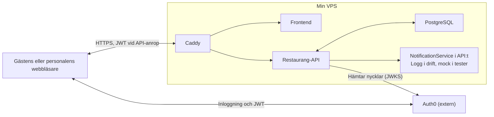

# Del 4: Teknikreflektion

## Fråga 1: CSRF och CORS

Jag har begränsat CORS till frontendens origin: lokalt `http://localhost:5173` och i drift värdet från `CORS_ALLOWED_ORIGINS`. En origin består av protokoll, värdnamn och port. Det låter frontenden anropa API:t från en annan origin, samtidigt som andra webbplatser inte får läsa svaren via JavaScript. CORS är ingen ersättning för autentisering och hindrar inte alla anrop från att skickas.

I `CorsConfig` tillåter jag bland annat headern `Authorization` och sätter `allowCredentials(false)`, eftersom API:t inte använder cookies för autentisering. Jag valde bort wildcard. Utan credentials hade `*` varit tillåtet, och en främmande sida saknar ändå användarens token. Ändå litar jag hellre bara på den klient jag känner till. Dessutom behöver jag inte ändra CORS-regeln om autentiseringen någon gång flyttas till cookies.

CSRF-skydd hindrar förfalskade ändringsanrop som utnyttjar att webbläsaren automatiskt skickar användarens inloggning, exempelvis en sessionscookie. CORS styr alltså åtkomst mellan origins, medan CSRF handlar om oönskade handlingar med offrets behörighet. I `SecurityConfig` har jag valt `STATELESS` och stängt av CSRF. Skälet är att klienten uttryckligen skickar JWT i `Authorization: Bearer`. Ett främmande formulär kan inte lägga till den headern eller få webbläsaren att automatiskt bifoga token. Försöker en främmande sida sätta headern med `fetch` stoppas anropet i preflight av min CORS-regel. Enbart stateless hade inte räckt som motivering, för en JWT i en cookie skickas också med automatiskt.

Om jag bytte till cookies måste CSRF slås på igen, och frontenden måste skicka en CSRF-token i en header. Ett förfalskat `POST /bookings/{id}/cancel` som släpps igenom med personalens cookie skulle annars kunna avboka gästens bord utan personalens avsikt. I nuvarande arkitektur skulle däremot aktiverat standardskydd utan CSRF-token ge 403 även vid legitima bokningsanrop.

## Fråga 2: SOAP och WSDL

Mitt API tar emot JSON via exempelvis `POST /bookings`. SOAP är ett protokoll för XML-meddelanden, ofta över HTTP. Ett meddelande omsluts av `Envelope`, har en valfri `Header` för metadata och en obligatorisk `Body` med begäran eller svar. Vid fel innehåller `Body` en `Fault` med `Code`, en läsbar `Reason` och en strukturerad `Detail`. `Code` säger om felet låg hos avsändaren (`Sender`) eller mottagaren (`Receiver`). Ett system från 2009 kör troligen SOAP 1.1, där fel kan komma med HTTP 200. Klienten måste därför läsa meddelandet, inte bara statuskoden.

WSDL beskriver tjänstens kontrakt i XML. I WSDL 1.1 definierar `types` datatyper med XSD, `message` in- och utmeddelanden och `portType` operationerna. `binding` anger hur operationerna skickas och `service` tjänstens adress.

Mot hotellkedjan skulle jag arbeta contract-first. Min OpenAPI genereras av springdoc från koden, men här genererar jag en SOAP-klient från hotellets WSDL, exempelvis med Apache CXF. Klienten läggs i ett integrationslager som mappar restaurang, tidpunkt och sällskapsstorlek till hotellets XML-typer. Ett `Receiver`-fel kan försökas igen med backoff. Ett `Sender`-fel blir ett 4xx-svar med `ProblemDetail` till frontenden. Logiken i `BookingService` kan återanvändas.

Det mesta i WSDL har en motsvarighet i OpenAPI, till exempel `types` och `components/schemas`. Det WSDL ger som OpenAPI saknar är `binding`: SOAP-version, `document/literal`, transport och `soapAction` per operation. REST behöver inget sådant, eftersom det alltid går över HTTP. Jag skulle behålla REST för frontenden, men måste använda SOAP mot hotellet.

## Fråga 3: Driftsättning

Jag vägde Render, Hetzner och HostUp mot varandra. Render är en PaaS. Hetzner och HostUp är VPS:er där jag kör containrar. Min tjänst består av fem delar: två API:er, frontenden, PostgreSQL och Caddy.

Render har minst driftsansvar, eftersom leverantören sköter operativsystem, TLS och deploy. Gratisnivån fungerar dock som scale-to-zero. Tjänsten somnar efter 15 minuter, och nästa anrop får vänta ungefär en minut på att JVM:en och Spring startar. Den kallstarten är för lång för en tjänst som måste svara direkt vid redovisningen. Gratisdatabasen raderas dessutom efter 30 dagar. Starter är alltid igång men kostar 7 dollar per tjänst och månad, och jag har flera tjänster.

En VPS kostar ett fast pris oavsett trafik. HostUp XS kostar ungefär 39 kronor i månaden för 4 GB RAM. Hetzner har motsvarande maskin men är dyrare och ligger utanför Sverige, så jag valde HostUp. Priset syns inte på fakturan. Jag patchar, övervakar och startar om allt själv: SSH, brandvägg, uppdateringar, Docker och Caddy. Jag ville lära mig att sätta upp en server med SSH-nycklar, och det var svårare än på Render. Det är kostnaden för valet.

Med tusen samtidiga användare blir maskinen flaskhalsen. Båda JVM:erna och databasen delar 4 GB, och varje API körs i en enda instans. Min deploy startar om containern, så tjänsten är nere en kort stund. Jag skulle först uppgradera till en större VPS. Därefter behövs flera instanser bakom en lastbalanserare, rullande uppdateringar och en separat databas. Då väger Renders betalda nivå med automatisk skalning tyngre igen.

## Fråga 4: End to end

Min frontend, Caddy, API:t och PostgreSQL körs på samma VPS. Auth0 sköter inloggningen utanför VPS:en, och mitt API validerar JWT. Aviseringen ligger i API:t och skriver just nu bara en loggrad genom `LoggingNotificationService`. I testerna ersätter jag den med en mock.

Jag ser aviseringen som en svag punkt om jag kopplar in en riktig e-posttjänst. I `BookingService.confirm` körs den synkront inom `@Transactional`. Det betyder att bekräftelsen väntar tills aviseringen är klar. Om aviseringen kastar en `RuntimeException` rullas databasändringen tillbaka, och bokningen förblir `REQUESTED`. Min `ApiExceptionHandler` svarar då med 500.

Personalen ser att bekräftelsen misslyckades. Gästen får ingen bekräftelse, och bokningen står kvar som väntande när den hämtas igen. Det kan göra att gästen ringer restaurangen för att fråga om bordet verkligen är bokat.

För att upptäcka problemet skulle jag mäta antalet misslyckade aviseringar och antalet 500-svar från `POST /bookings/{id}/confirm`. Jag skulle också följa svarstiden och sätta ett larm när felen ökar. Då kan jag upptäcka problemet innan fler gäster hör av sig. Den övervakningen har jag inte byggt ännu.

## Fråga 5: Spring Cloud

Idag ligger restauranger, bokningar och aviseringar i samma applikation. Min `BookingService` använder `RestaurantRepository` och `NotificationService` direkt. Om jag delar upp dem behöver tjänsterna kommunicera över nätverket. Då måste jag hantera adresser, flera ingångar och risken att en annan tjänst inte svarar. Spring Cloud är en samling verktyg som hjälper mig med sådana problem.

Det första problemet är att bokningstjänsten måste hitta restaurang- och aviseringstjänsterna även om deras adresser ändras. Med **Spring Cloud Netflix Eureka** från kapitel 23 kan tjänsterna registrera sina instanser i ett tjänsteregister. Bokningstjänsten kan då slå upp exempelvis `notification-service` med hjälp av `DiscoveryClient`, i stället för att jag hårdkodar en IP-adress och port.

Det andra problemet är att frontenden annars kan behöva känna till flera API-adresser. Med **Spring Cloud Gateway** från kapitel 24 får jag en gemensam ingång. Jag kan låta anrop till `/restaurants/**` gå till restaurangtjänsten och `/bookings/**` till bokningstjänsten. Aviseringstjänsten kan anropas internt av bokningstjänsten. Jag behöver fortfarande hantera behörigheter och fel i respektive tjänst.

Jag skulle behålla min nuvarande lösning så länge tjänsterna är få och adresserna stabila. Caddy och Docker Compose räcker för min drift idag. Spring Cloud blir mer relevant om tjänsterna flyttas mellan servrar eller körs i flera instanser.

## Motivering om mina val i Del 1-2

### Paginering: offset eller cursor

Jag valde offset-paginering för `GET /restaurants` med Springs `Pageable`, till exempel `?page=0&size=10`. Svaret blir en `Page<RestaurantResponse>` med sidmetadata, som totalt antal och antal sidor. Restaurangerna är få och ändras sällan, och Spring Data JPA ger offset utan egen kod. Cursor valde jag bort. Den passar stora tabeller som ändras ofta, där offset kan hoppa över eller upprepa rader mellan två sidor och stora offset blir långsamma. Det problemet har inte min tjänst.

### Mockning: Mockito eller WireMock

Jag valde Mockito. Aviseringstjänsten finns inte i verkligheten, så `NotificationService` är ett interface. I drift används `LoggingNotificationService`, som bara loggar, och i testerna ersätter jag den med `@MockitoBean`. Testet kontrollerar att `confirm` anropar aviseringen en gång med rätt boknings-id och e-post, och inte alls när övergången nekas med 409. WireMock valde jag bort. Det kräver en HTTP-klient med en adress, och i drift hade den adressen antingen gett fel eller krävt en extra stubtjänst. Nackdelen med mitt val är att inget HTTP-kontrakt testas. Om tjänsten hade funnits på riktigt hade jag valt WireMock.

## Känd bugg i min backend

Jag har en känd bugg i backend där bokningarna saknar `ownerId` och ägarkontroll. Det gör att en inloggad gäst kan hämta andra gästers bokningar via API:t.

Inför redovisningen har jag en tillfällig lösning i frontend. Under ”Mina bokningar” visas bara bokningar där e-postadressen matchar den inloggade användarens konto. Det gör att listan ser rätt ut, men säkerhetsproblemet finns fortfarande kvar eftersom alla bokningar kan finnas i API-svaret.

Det som återstår är att koppla bokningarna till användaren och kontrollera ägarskapet i backend. Gäster ska bara kunna hämta sina egna bokningar.
